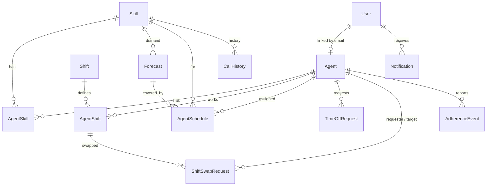

# Workforce360 — Call Center Workforce Management

Forecasts call volume, converts it to required agents, schedules agent shifts automatically and tracks
adherence, time-off, shift swaps and historical performance.

| Part | Folder | Stack |
|---|---|---|
| Web app | `/` (`src/`) | React 19 + TypeScript, Redux Toolkit, Tailwind, socket.io-client |
| API | `call-center-backend/` | NestJS 12, Prisma 7, PostgreSQL, JWT, WebSocket gateway, Redis (optional) |
| Forecast / optimiser | `forecasting-service/` | FastAPI, Prophet, Erlang C, OR-Tools CP-SAT |

> **All times are UTC.** Shifts store only the time of day; schedules and forecasts use 30-minute intervals.

## Architecture

```
React (Vite) ──REST + WebSocket──▶ NestJS API ──SQL──▶ PostgreSQL
                                      │  └─────────────▶ Redis (live queue metrics, optional)
                                      └──HTTP──▶ FastAPI: Prophet forecast · Erlang C · OR-Tools scheduler
```

Flow: **import call history → generate forecast (Prophet + Erlang C) → auto-schedule day (OR-Tools; greedy fallback)
→ live staffing, adherence and reports**.

## Quick start (local)

Prerequisites: Node 24, Python 3.13+, PostgreSQL.

```bash
# 1. API
cd call-center-backend
cp .env.example .env          # set DATABASE_URL and JWT_SECRET
npm ci
npx prisma migrate deploy
npm run seed                  # imports call history, makes first user admin  (add -- --demo for demo agents)
npm run start:dev             # http://localhost:3000

# 2. Forecast service
cd forecasting-service
python -m venv venv && venv/Scripts/activate      # Linux/macOS: source venv/bin/activate
pip install -r requirements.txt
uvicorn app:app --port 8000

# 3. Web app
npm ci
cp .env.example .env          # VITE_API_URL=http://localhost:3000
npm run dev                   # http://localhost:5173
```

The **first account that signs up becomes `admin`**; everyone after that is an `agent` until an admin promotes them
(Users & Roles page). Redis and SMTP are optional — without them the app uses an in-memory metrics store and
skips e-mail.

### Windows one-click start

After the one-time setup above, double-click **`start.bat`** (runs the API, forecast service and website and opens
`http://localhost:5173`). **`stop.bat`** stops all three. Check the services at
`localhost:3000/health`, `localhost:8000/health` and `localhost:5173`.

### Demo data and logins (local development only)

```bash
cd call-center-backend
npm run seed -- --demo --agents=800     # imports call history + 800 demo agents with shifts (@demo.local)
node scripts/demo-fill.mjs              # forecast + schedule for today/tomorrow, demo admin and sample requests
node scripts/demo-requests.mjs          # sample time-off, shift-swap and adherence stories
npm run seed -- --clean-demo            # removes the demo agents again
```

| Role | Login | Password |
|---|---|---|
| Admin | `demo-admin@demo.local` | `Demo#12345` |
| Agent | `agent004@demo.local` | `Demo#12345` |

These accounts only exist in a local database after running the scripts above. Never use such passwords in production.

Typical walkthrough: **Reports → Import** call history → **Forecast → Generate forecast** → **Agent Schedule → Auto-schedule day**
(use the same date) → **Dashboard** (click a row to see the scheduled agents) → log in as an agent to see **My Dashboard**.

### Docker

```bash
JWT_SECRET=$(openssl rand -hex 32) docker compose up --build
# web http://localhost:8080 · api http://localhost:3000 · forecast http://localhost:8000
```

## Roles

| Role | Can do |
|---|---|
| `admin` | everything, manage user roles |
| `manager`, `planner` | agents / skills / shifts, generate forecasts and schedules, import history, reports, approvals |
| `supervisor` | view agents, approve time-off & swaps, adherence, reports, publish queue metrics |
| `agent` | own schedule, request time-off, request/accept shift swaps, set own status |

## Data model



## API overview

All routes except `/health`, `POST /auth/signup` and `POST /auth/login` need `Authorization: Bearer <jwt>`.

| Area | Endpoints |
|---|---|
| Auth | `POST /auth/signup`, `POST /auth/login`, `GET /users/me`, `GET /users` *(admin)*, `PATCH /users/:id/role` *(admin)* |
| Master data | `GET/POST /agents`, `GET /agents/me`, `POST /agents/:id/shifts`, `POST /agents/:id/skills`, `GET/POST /skills`, `GET/POST /shifts` |
| Forecast | `POST /forecast/generate`, `POST /forecast`, `GET /forecast?skill&channel&date`, `GET /forecast/multi-channel` |
| Scheduling | `POST /agent-schedule/generate-day`, `POST /agent-schedule/generate`, `POST /agent-schedule`, `GET /agent-schedule?date&skill`, `DELETE /agent-schedule/:id` |
| Live | `GET /dashboard`, `GET /realtime/staffing`, `GET/POST /realtime/queue-metrics`, WebSocket events `staffing:update`, `notification` |
| Requests | `POST/GET /time-off`, `PATCH /time-off/:id/review\|cancel`, `POST/GET /shift-swaps`, `GET /shift-swaps/candidates`, `PATCH /shift-swaps/:id/respond\|review\|cancel` |
| Adherence | `POST /adherence/events`, `GET /adherence?date` |
| Reports | `POST /reports/import`, `GET /reports/performance`, `GET /reports/forecast-accuracy` |
| Notifications | `GET /notifications`, `PATCH /notifications/read-all`, `PATCH /notifications/:id/read` |

Forecast service (internal): `GET /health`, `POST /forecast`, `POST /staffing`, `POST /schedule/optimize`.

### How the pieces work

* **Staffing** – Erlang C against a service-level target (Voice 80/20, Chat 80/30 with 2 concurrent chats, Email by workload at 90 % occupancy).
* **Scheduler** – CP-SAT maximises covered demand and then evens out workload. Agents need the skill, be on shift (night shifts handled), not on approved leave and not already booked. If the Python service is down, a greedy heuristic with the same inputs is used (`SCHEDULER_ENGINE=greedy` forces it).
* **Shift swap** – requester → colleague accepts → manager approves; the swap is applied atomically and stale generated schedule entries are cleared.
* **Adherence** – % of scheduled time spent `Available`/`OnCall`, from agent status events.

## Tests

```bash
cd call-center-backend && npm test         # unit tests (scheduler, adherence, guards, reports, time-off)
cd call-center-backend && npm run test:e2e # needs a running PostgreSQL
cd forecasting-service && python -m pytest # Erlang C, optimiser, API
npm run lint && npm run build              # frontend
```

CI (`.github/workflows/ci.yml`) runs all of the above; set repository variable `AWS_DEPLOY_ENABLED=true` plus the AWS secrets to
build/push images to ECR and roll ECS services.

## Configuration

See `call-center-backend/.env.example`. Important: `DATABASE_URL`, `JWT_SECRET` (required in production),
`FORECAST_SERVICE_URL`, optional `REDIS_URL` and `SMTP_*`.

## Known limits

* Prophet is trained on the imported history only; forecasting far beyond the last imported day extrapolates the trend — import fresh data regularly.
* `breakMinutes` on a shift is informational; breaks are not scheduled inside the shift.
* Docker images and the ECS deploy job were written but not run in the development environment.
